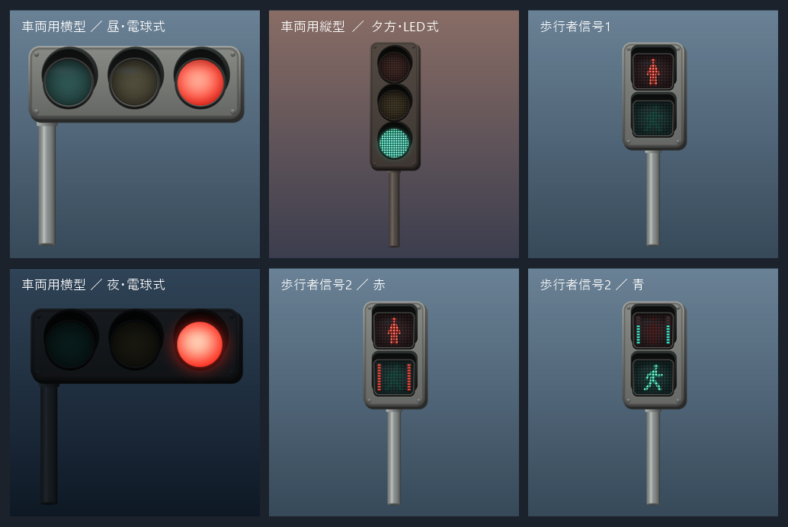

# 交通信号 / SYNC_SignalLight

道路や交差点、横断歩道の映像に重ねて使える AviUtl ExEdit2 のメディアオブジェクトです。車両用と歩行者用の信号機を配置し、点灯の切り替えや時間帯による明暗を表現できます。

## 導入

AviUtl ExEdit2 2.1.16 以降（Windows 64 ビット）で使えます。

1. 配布ページから SYNC_SignalLight.zip をダウンロードして展開します。[最新版の配布ページ](https://github.com/vramwiz/SYNC_SignalLight/releases/latest)
2. 展開した SYNC_SignalLight フォルダーごと AviUtl2 の Plugin フォルダーに置きます。標準の配置先は C:\ProgramData\aviutl2\Plugin\SYNC_SignalLight です。
3. AviUtl2 を起動し、オブジェクトを追加するメニューの「SYNC」から「交通信号」を選びます。

更新する場合は、AviUtl2 を終了してから新しい版を上書きしてください。削除する場合は、Plugin フォルダー内の SYNC_SignalLight フォルダーを取り除きます。

## 信号機の種類

| 種類 | 特徴 | 点灯順 |
| --- | --- | --- |
| 車両用横型 | 支柱は左側 | 赤 → 青 → 黄 |
| 車両用縦型 | 支柱は中央 | 赤 → 青 → 黄 |
| 歩行者信号1 | 人物マークの標準型 | 赤 → 青 → 青点滅 |
| 歩行者信号2 | 人物マークと残り時間の目盛り | 赤 → 青 → 青点滅 |

歩行者信号2では、赤信号の間は下段の左右に赤い目盛りが、青信号と青点滅の間は上段の左右に青い目盛りが出ます。左右それぞれ10段で、区間の残り時間に応じて上から消灯します。

## 外観

- 「点灯方式」で電球式と LED 式を切り替えます。「外観」で本体・支柱・遮光フードの色、点灯色の補正、支柱の長さを調整できます。
- 「付属物」で支柱と遮光フードを個別に表示・非表示にできます。
- 「専用拡大率 (%)」は 25～600% です。指定した大きさで輪郭やレンズを描画します。位置、回転、透明度は AviUtl2 の標準項目で調整します。
- 「時間帯」は 0.00～24.00 の手動設定です。12.50 は 12 時 30 分に相当し、0.00 と 24.00 は同じ見え方です。夜は灯火の周りの光が広がります。

## 点灯の調整

「シーケンス」で初期信号状態、各区間の長さ、点滅周期、時間オフセットを設定できます。初期値は赤から始まる各3.00秒の繰り返しです。

- 各区間を 0 秒にすると、その区間を省略します。繰り返しを解除すると、一周した時点で初期色に戻ります。
- 正のオフセットを指定すると、点灯が途中から始まります。赤が 3.00 秒でオフセットが 2.00 秒なら、配置開始から 1.00 秒後に青へ切り替わります。
- 複数の信号機のタイミングは、各オブジェクトの初期信号状態とオフセットで調整できます。

## ライセンス

GPL-3.0-only で配布しています。[ライセンス全文](LICENSE) · [SDK のライセンス表示](THIRD_PARTY_NOTICES.md)
